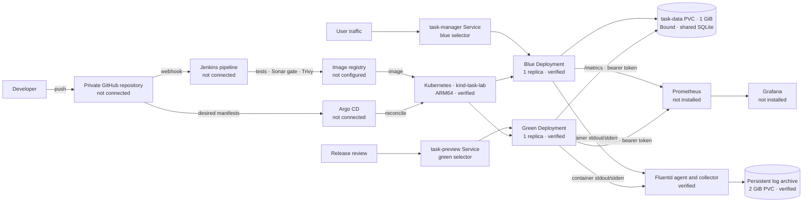

# Task Manager Delivery Architecture

The diagram shows the intended delivery path and the local runtime topology. CI, registry publication, Argo CD, Prometheus, Grafana and Fluentd are configured in source but remain unverified until their services are connected and run. The two application slots and the kind deployment were verified locally.

## Traffic and persistence

The live Service selects `slot: blue`; the preview Service selects `slot: green`. A Git change can switch both selectors as one promotion, then revert them for rollback. Both deployments mount the same PVC. This is suitable only for the single-node lab: SQLite and a shared local filesystem do not provide safe multi-node database semantics.

## Evidence boundary

Solid topology labels marked verified were inspected against the running local cluster. Integrations explicitly marked “not connected” or “not installed” are design intent only. See [EVIDENCE.md](EVIDENCE.md) for the rubric mapping.
