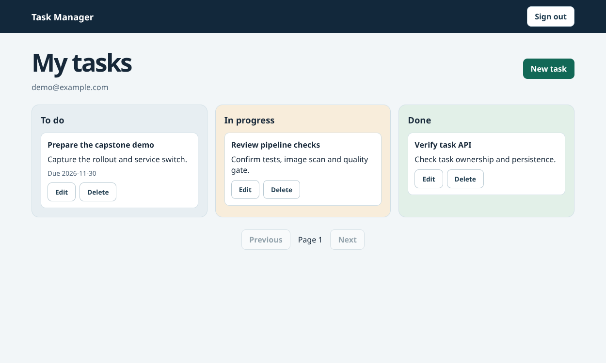

# Task Manager Technical Report

**ENSP461 · DevOps & Automation Lab · B.Tech CSE Semester VII**  
**Kartik Manchanda · 23 November 2026**

## Problem statement

Manual software delivery makes builds difficult to reproduce and failures difficult to recover from. This capstone uses a small task tracking application to demonstrate how automated tests, containers, Kubernetes, infrastructure tooling, monitoring, logging, and declarative delivery fit together. The implementation is deliberately local and low cost. Its results below distinguish verified work from integrations that still need an authorized GitHub or Jenkins service.

## Objectives

- Deliver registration, login, isolated task CRUD, and persistent storage.
- Test the API and package it as a restricted container.
- Deploy to an ARM64 kind cluster and verify scaling, update, rollback, and data persistence.
- Define a Git based CI/CD path and prepare infrastructure, monitoring, logging, and GitOps configuration.
- Preserve secrets and local data while collecting reproducible evidence.

## Architecture

The browser sends requests to a Node.js HTTP service. The service hashes passwords, issues opaque sessions, scopes task queries by user, and uses revision checks for updates. SQLite stores the records. In Compose the database is on the existing named volume; in Kubernetes both release slots mount the same single node PVC. Blue is the live Service target and green is the preview target. A reviewed manifest change can switch the Service selectors. See the standalone [architecture diagram](ARCHITECTURE.md).

The intended delivery path is GitHub push → Jenkins tests and image checks → registry image → Argo CD reconciliation of Kubernetes manifests. Prometheus scrapes authenticated app metrics, Grafana presents metrics, and Fluentd tails container logs into a persistent archive. Terraform manages the local kind cluster declaration; Ansible builds and deploys the app from the workstation. External Git hosting, registry publication, Jenkins, SonarQube, and Argo CD need service configuration and credentials.

## Tools and safeguards

| Area | Implementation |
|---|---|
| Application | Node.js 24, SQLite, static HTML/CSS/JavaScript |
| Tests | Node built-in test runner and HTTP integration test |
| Containers | Dockerfile and Compose named volume |
| Kubernetes | kind, kubectl, Kustomize, Secret reference, ConfigMap, PVC, probes and two deployments |
| Infrastructure | Terraform built-in `terraform_data`; Ansible local deployment play |
| CI design | Jenkinsfile stages for tests, SonarQube gate, smoke test, Trivy and optional registry publication |
| Observability design | Prometheus ServiceMonitor, Grafana dashboard, Fluentd agent and collector manifests |
| Safety | Non-root app, dropped capabilities, read-only root filesystem, scoped observer Role, no credentials in source |

## Verified results

The `npm test` integration suite passed with one test and zero failures. It covers registration, duplicate registration rejection, login errors, task creation, read/update/delete isolation between accounts, stale revision detection, logout, protected metrics, and persistence across a server restart.

Docker Compose built and started the image. Its readiness endpoint returned HTTP 200 with `{"ok":true}`. Compose was stopped with `docker compose down`; the `tasks` named volume was retained.

The existing kind cluster was reachable on ARM64. Terraform validated, applied an idempotent cluster declaration, and then produced a no-change plan. The Ansible workstation play completed with six successful tasks and no failures. Both blue and green Pods became Ready. The Task Manager and preview Services, settings ConfigMap, Opaque `task-secrets` reference, `task-data` PVC, readiness probe and observer Role were present. The PVC was Bound at 1 GiB.

The Service readiness endpoint returned HTTP 200 through port forwarding. A generated disposable account and task survived scaling blue to two replicas and restarting the deployment; the verifier reconnected to the Service after the rollout and retrieved the task with HTTP 200. Blue was returned to one replica. The existing `ops/verify-kind.sh` then built a distinct ARM64 image with a visible page title change, loaded it into kind, rolled blue to `task-manager:lab-v2`, and undid the rollout. After rollback, the live Service returned readiness HTTP 200 and the original `Task Manager` page title. Both slots ended healthy at one replica.

A demo observer service account and RoleBinding could read Pods and Pod logs but could not read Secrets. The credential value was not displayed. Fluentd's collector and agent reached Ready, its 2 GiB archive claim bound, and the archive held Kubernetes system records. After five readiness requests through the application Service, the archive contained 79 blue application container log records. Terraform's final plan reported no changes.

## Not verified in this environment

No `.git` directory or Git remote existed in the supplied folder. The GitHub CLI was absent and no authorized private repository URL was supplied. Therefore no repository URL, commits, branch merge, conflict resolution, push trigger, Jenkins build, SonarQube gate, Trivy result, or image publication can be claimed.

Helm did not become available after the Homebrew attempt, so Prometheus and Grafana were not installed and metrics traffic or resource charts were not verified. Argo CD was not installed or connected to Git; blue/green transitions through Git reconciliation were not performed. The provided pipeline and manifests are configuration, not evidence that those services ran.

The host provisioning Ansible play targets Ubuntu x86-64, which is not this Apple Silicon workstation. The workstation deployment play was used instead. This route is recorded and verified; provisioning of a separate Ubuntu host remains unverified. No recording facility was available during this run, so a timed recording script is supplied instead of a video. The PowerPoint export could not be generated because the presentation authoring runtime dependency was unavailable.

## Challenges and future scope

The initial sandbox denied localhost binding and Docker/Kubernetes sockets. With approved local access, the app tests and deployments completed. A port-forward can terminate when its selected Pod is replaced, so the persistence verifier reconnects after rollout. Terraform's first failed provisioner attempt tainted its data resource; the resulting plan included a replacement action but could only reuse the existing cluster and completed without deleting it. The plan is now clean.

Future work is to connect an authorized private remote, configure isolated Jenkins and registry credentials, install monitoring and GitOps services, capture real dashboards and archive output, and produce the final PowerPoint and video. A production deployment should move from shared local SQLite to a network database with backups before scaling across nodes.

## Reproduction

Follow [README.md](../README.md), then use [RUNBOOK.md](RUNBOOK.md) for optional integrations and [EVIDENCE.md](EVIDENCE.md) for the precise status and command mapping. Keep the existing `data/` directory and Docker Compose volume when repeating checks.
